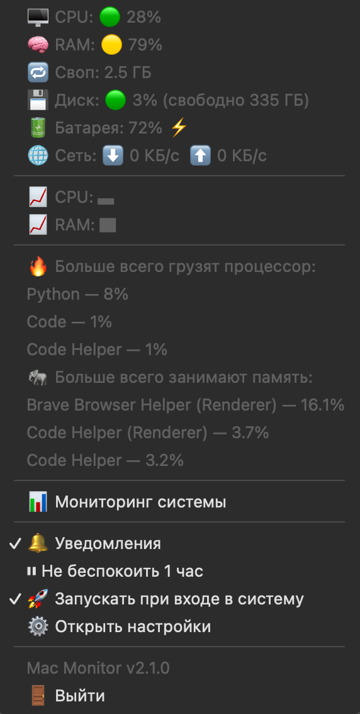

# 🖥 Mac Monitor

Маленький монитор системы для строки меню macOS с **умными предупреждениями**. Показывает нагрузку на процессор и память прямо в строке меню и предупреждает, когда что-то по-настоящему грузит Mac, причём называет, *какая программа* виновата.

🇬🇧 [Read in English](README.md)

<p align="center"></p>

## ✨ Возможности

- 🖥 🧠 CPU и RAM в строке меню со светофором 🟢🟡🔴
- В выпадающем меню: своп 🔁, диск 💾, батарея 🔋, скорость сети 🌐, мини-графики 📈
- 🔥 Топ-3 программ по процессору и 🐘 по памяти (процессы одной программы складываются, например Chrome)
- 🔔 Умные уведомления: только если нагрузка высокая около 12 секунд подряд, называют виновника, не спамят (пауза между повторами)
- ⏸ «Не беспокоить» на 1 час
- 🚀 Переключатель «Запускать при входе в систему» прямо в меню
- 🪶 Лёгкая: пониженный приоритет, медленные данные проверяются реже
- 🌍 Интерфейс на русском и английском (выбирается сам)
- ⚙️ Настройки в простом JSON-файле
- Запускается только в одном экземпляре, ошибки пишутся в лог

## 📦 Установка

Два способа, программа одна и та же:

### Вариант А: приложение (Python не нужен)

1. Скачай на странице [Releases](../../releases) архив для **своего** Mac и распакуй:
   - `MacMonitor-apple-silicon.zip`: Mac с чипом Apple (M1, M2, M3 и новее)
   - `MacMonitor-intel.zip`: Mac с процессором Intel

   Не знаешь, какой у тебя? Нажми  → *Об этом Mac*: там написано **Чип** (Apple) или **Процессор** (Intel).
2. Перетащи **Mac Monitor.app** в папку **Программы** и открой.

Приложение не подписано платным сертификатом Apple Developer, поэтому при первом запуске macOS его блокирует:

- **macOS 15 и новее:** попробуй открыть приложение, затем зайди в *Системные настройки → Конфиденциальность и безопасность* и нажми **Всё равно открыть**.
- **Более старые macOS:** правый клик по приложению → **Открыть**.
- **Или в Терминале:** `xattr -dr com.apple.quarantine "/Applications/Mac Monitor.app"`

### Вариант Б: скрипт

Нужен Python 3.9+.

```bash
git clone https://github.com/3jlouletvik/mac-monitor.git
cd mac-monitor
python3 -m venv venv
source venv/bin/activate
pip install -r requirements.txt
python mac_monitor.py
```

## 🔨 Собрать приложение самому

```bash
bash build_app.sh
```

Приложение собирается под процессор того Mac, на котором ты запускаешь команду. Получится `dist/Mac Monitor.app` и `dist/MacMonitor-apple-silicon.zip` (или `dist/MacMonitor-intel.zip`). Такая же сборка запускается на GitHub Actions для обоих типов процессора: отправь тег вида `v2.1.1`, и оба архива сами прикрепятся к релизу.

## ⚙️ Настройки

Нажми **⚙️ Открыть настройки** в меню. Файл лежит в `~/Library/Application Support/MacMonitor/config.json`. После правки **перезапусти приложение**.

| Ключ | По умолчанию | Что значит |
| --- | --- | --- |
| `language` | `"auto"` | `"auto"`, `"en"` или `"ru"` |
| `limits.cpu` / `limits.ram` / `limits.disk` | `85` / `85` / `90` | при каком % нагрузка считается высокой |
| `battery_low` | `20` | предупредить при таком заряде или ниже |
| `checks_in_row` | `4` | сколько проверок подряд (по 3 сек) должно быть «высоко» перед предупреждением |
| `cooldown_minutes` | cpu 10, ram 10, disk 360, battery 10 | минимальная пауза между повторными предупреждениями |
| `notifications` | `true` | уведомления включены при запуске |

Неверное или отсутствующее значение просто игнорируется, берётся значение по умолчанию.

## 🩺 Если что-то не так

- **Окно «Launch error» при открытии приложения:** ты скачал архив для другого типа процессора. Скачай второй (см. Установка → Вариант А).
- **Нет уведомлений:** открой *Системные настройки → Уведомления* и разреши их для **Script Editor** (macOS отправляет их через него).
- **Что-то сломалось:** посмотри `~/Library/Logs/MacMonitor.log` и приложи его к обращению (issue).
- **Нет температуры и оборотов вентиляторов:** macOS не отдаёт их обычным программам без прав администратора или дополнительных утилит.

## 📄 Лицензия

[MIT](LICENSE)

Автор: [s(l)izzy](https://github.com/3jlouletvik).
